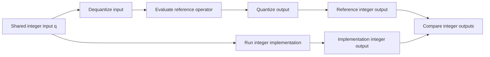

A quantized neural network deliberately changes the numbers it computes with. That makes testing surprisingly subtle: when an output differs from the original model, how do we tell whether the difference is expected quantization error or an implementation bug?

The key is to give the implementation and its reference **the same represented inputs and the same output quantization rule**. We can then check whether the implementation performs the specified computation. Measuring how much quantization affects the model's predictions is a separate, equally useful test.

This article develops that distinction from a small numerical example to a mathematical proof, then shows why ordinary floating-point arithmetic complicates exact comparisons. You need basic algebra and an understanding of unit tests; previous experience writing quantized kernels is optional. A *kernel* here simply means the implementation of an operation, such as matrix multiplication, in an inference runtime.

The starting point is the testing procedure in Lei Mao's [Quantization for Neural Networks](https://leimao.github.io/article/Neural-Networks-Quantization/#Quantization-Implementation-Unit-Tests). It compares integer outputs against a reference computed from quantized and then dequantized inputs. The derivations below explain why that construction works and state the assumptions needed for exact agreement.

## Where quantization fits

During *inference*, a trained model processes new inputs to make predictions. Its weights are learned parameters; its activations are the intermediate values produced as inputs move through the model. These values are stored in *tensors*, which are multidimensional arrays.

Integer quantization represents such values using a finite set of integer codes together with parameters that describe what each code means. For example, replacing a 32-bit value with an 8-bit code reduces the raw storage for that value from four bytes to one, before accounting for metadata. Suitable hardware can also perform the resulting computations more efficiently. Actual benefits depend on the model and runtime. [TensorFlow's quantization overview](https://www.tensorflow.org/model_optimization/guide/quantization/training) describes the deployment motivation.

Two common workflows lead to quantized inference:

- **Post-training quantization (PTQ)** converts an already trained model. Some forms use representative data to determine suitable quantization parameters. See the [TensorFlow PTQ guide](https://www.tensorflow.org/model_optimization/guide/quantization/post_training).
- **Quantization-aware training (QAT)** simulates quantization during training so the model can adapt to it. A typical simulation rounds values to a quantization grid while continuing to store them as floating-point values. This is called *fake quantization*. See the [TensorFlow QAT guide](https://www.tensorflow.org/model_optimization/guide/quantization/training).

Both workflows need reliable operators at deployment. It helps to distinguish three questions:

| Question | What to compare |
| --- | --- |
| Does the quantized model retain useful accuracy? | Predictions or evaluation metrics on representative data. |
| Does this kernel implement the chosen numerical specification? | Its output codes against a reference for that specification. |
| Does this kernel agree with a particular deployment backend? | Its outputs against that backend's arithmetic rules and permitted tolerances. |

This article focuses on the second question and explains how the third can change the reference. We hold quantization parameters fixed for each comparison. Choosing those parameters, including calibration or dynamic parameter estimation, requires its own checks.

## Integer codes and the values they represent

Consider an evenly spaced grid of representable values. The **scale** $s$ is the distance between adjacent grid points. The **zero point** $z$ is the integer code that represents real zero.

We use the following affine quantization and dequantization functions:

$$
\begin{equation}
Q_{s,z}(x)
=
\operatorname{clip}_{[q_{\min},q_{\max}]}
\left(R\left(\frac{x}{s}+z\right)\right),
\qquad
D_{s,z}(q)=s(q-z).
\notag
\end{equation}
$$

Here $s>0$, the endpoints and $z$ are integers, and $R$ is a deterministic rounding rule that leaves integers unchanged. For example, *round to nearest, ties to even* chooses the nearest integer and resolves an exact halfway case by choosing the even one: $R(0.5)=0$ and $R(1.5)=2$. Clipping, also called *saturation*, clamps a result to the allowed integer range.

For a small example, use $s=0.25$, $z=4$, and integer codes from $0$ through $15$. The represented real values range from $-1$ to $2.75$.

| Original value $x$ | Stored code $Q(x)$ | Represented value $D(Q(x))$ |
| --- | --- | --- |
| $-0.4$ | $2$ | $-0.5$ |
| $0$ | $4$ | $0$ |
| $0.6$ | $6$ | $0.5$ |
| $4$ | $15$ | $2.75$ |

The third row illustrates rounding; the last illustrates clipping. In particular, code $6$ means $0.5$ under these parameters. Arithmetic on codes must account for that meaning.

The notation used throughout the article is:

| Symbol | Meaning |
| --- | --- |
| $x$ | An original real input, or a collection of inputs. |
| $q$ | An integer encoding of an input. |
| $\widehat x=D_x(q)$ | The real value represented by that encoding. |
| $Q_x,D_x$ | Input quantization and dequantization. |
| $Q_y,D_y$ | Output quantization and dequantization, possibly with different parameters. |
| $f$ | The mathematical operation we want to compute. |
| $K$ | Its implementation that accepts and returns integer codes. |

For tensors, quantization acts element by element. Quantized weights and biases count as inputs too, each with their own parameters. The notation initially uses one scale and zero point per tensor. The equivalence proof also applies to fixed parameters per channel, provided every element uses the correct positive scale and zero point.

The placement of rounding is part of the specification. This article puts $z$ inside $R$. Moving it outside can change halfway cases under ties-to-even rounding: $R(0.5+1)=2$, while $R(0.5)+1=1$. A reference must follow the convention of the implementation being tested.

### What survives a round trip?

Fake quantization has the forward mapping

$$
\begin{equation}
P(x)=D(Q(x)).
\notag
\end{equation}
$$

It snaps a value to the grid and returns the represented value. As the table shows, $D(Q(x))$ generally differs from $x$.

There is a useful identity in the opposite direction. For every legal integer code $q$, **in exact arithmetic**,

$$
\begin{equation}
Q(D(q))
=
\operatorname{clip}\left(
R\left(\frac{s(q-z)}{s}+z\right)
\right)
=
\operatorname{clip}(R(q))
=
q.
\tag{1}
\end{equation}
$$

Decoding a code and encoding it again recovers the code. This follows because the scale cancels, rounding preserves an integer, and clipping preserves a value already in range. It does not recover information lost when the original real input was quantized.

Until the section on floating-point arithmetic, all real-valued formulas use exact arithmetic. We also assume that $f$ is defined on every decoded legal input and that $K$ returns legal output codes.

## Constructing a reference for the same computation

Suppose we want to test a quantized implementation $K$ of an operation $f$. Its quantization parameters are arguments or configuration of the kernel; we omit them from $K(q)$ to keep the equations readable.

A reference comparison proceeds as follows:

1. Fix the input and output parameters, integer ranges, and rounding rules.
2. Choose legal integer inputs $q$, either directly or by quantizing real inputs: $q=Q_x(x)$.
3. Decode those inputs and evaluate the mathematical reference: $f(D_x(q))$.
4. Quantize the reference output using the output parameters, and compare it with $K(q)$.



Both paths start from the same codes. In symbols,

$$
\begin{aligned}
q_{\mathrm{ref}}&=Q_y\bigl(f(D_x(q))\bigr),\\
q_{\mathrm{impl}}&=K(q).
\end{aligned}
$$

The equality being tested is therefore

$$
\begin{equation}
\boxed{
K(q)=Q_y\bigl(f(D_x(q))\bigr).
}
\tag{2}
\end{equation}
$$

**Equation (2) defines the ideal quantized operation.** An implementation satisfies it only if its computation matches the specified scaling, rounding, and clipping. Choosing an integer data type alone gives no such guarantee.

In code, the reference might use floating-point operations, exact rational arithmetic, or a carefully specified backend emulator. Those choices can give different answers near rounding boundaries, as we will see later.

## Why this is equivalent to fake quantization

The reference above has a precise connection to a fake-quantized forward computation. With fake quantization at the input and output of $f$, the result is

$$
\begin{equation}
F_{\mathrm{fake}}(x)
=
D_y\left(
Q_y\left(f(D_x(Q_x(x)))\right)
\right).
\notag
\end{equation}
$$

Read this from the inside outward: encode the input, decode it onto the grid, apply the operation, encode the output, and decode that output onto its grid.

Integer inference followed by output dequantization gives

$$
\begin{equation}
F_{\mathrm{int}}(x)=D_y\left(K(Q_x(x))\right).
\notag
\end{equation}
$$

We can now prove that matching the integer reference for every legal code is equivalent to matching this fake-quantized computation for every input. The proof concerns the forward pass; it makes no claim about the gradient approximations used in QAT.

### From integer correctness to forward equivalence

Assume Equation (2) holds for every legal input code. Substituting $q=Q_x(x)$ gives

$$
\begin{equation}
\begin{aligned}
F_{\mathrm{int}}(x)
&=D_y\left(K(Q_x(x))\right)\\
&=D_y\left(Q_y\left(f(D_x(Q_x(x)))\right)\right)\\
&=F_{\mathrm{fake}}(x).
\end{aligned}
\tag{3}
\end{equation}
$$

This proves sufficiency: satisfying the integer specification is enough to obtain the same decoded output.

### From forward equivalence to integer correctness

Now assume $F_{\mathrm{int}}(x)=F_{\mathrm{fake}}(x)$ for every $x$. Choose any legal integer input $q$ and set $x=D_x(q)$. Equation (1) gives $Q_x(x)=q$, so

$$
\begin{equation}
D_y(K(q))
=
D_y\left(Q_y(f(D_x(q)))\right).
\notag
\end{equation}
$$

Because $s_y>0$, output dequantization is *injective*: different codes represent different exact real values. Algebraically,

$$
\begin{equation}
D_y(a)=D_y(b)
\iff
s_y(a-z_y)=s_y(b-z_y)
\iff a=b.
\notag
\end{equation}
$$

The two output codes must therefore be equal, which is Equation (2). Combining both directions,

$$
\begin{equation}
\boxed{
\forall q,\ K(q)=Q_y(f(D_x(q)))
\iff
\forall x,\ F_{\mathrm{int}}(x)=F_{\mathrm{fake}}(x).
}
\tag{4}
\end{equation}
$$

Here $\forall$ means "for every," and $\iff$ means that the implication holds in both directions. This is the mathematical foundation of the reference comparison.

The quantization boundaries matter. A fused sequence of operations with one output quantizer can have different semantics from a sequence that rounds an intermediate result. Apply the theorem to the computation and quantization boundaries that the kernel actually promises to implement.

## When decoded outputs must also agree

Once the integer outputs agree, what does a second assertion on the dequantized outputs add? In exact arithmetic,

$$
\begin{equation}
D_y(q_{\mathrm{impl}})-D_y(q_{\mathrm{ref}})
=
s_y(q_{\mathrm{impl}}-q_{\mathrm{ref}}).
\tag{5}
\end{equation}
$$

Thus equality of the codes and equality of their represented values are equivalent.

On a real machine, equal integer tensors also produce identical floating-point bit patterns if both use **the same deterministic dequantization implementation, parameters, data type, and floating-point environment**. The multiplication may round, but the same computation rounds the same way on both calls. This second assertion can help check the output conversion path, although it follows from integer equality under those assumptions.

The reverse implication needs care on a machine: finite-precision decoding can, in some configurations, map distinct codes to the same floating-point value. Comparing the integer codes directly preserves the distinction. Also, a numerical floating-point equality assertion is not automatically a bit-pattern comparison; for example, positive and negative zero compare numerically equal.

## Worked operator proofs

The theorem specifies what an implementation should do. To prove a particular implementation correct, we still need to derive its computation. Matrix multiplication illustrates the scaling and accumulation; ReLU gives a smaller example that we can test exhaustively.

### Matrix multiplication with bias

A dense neural-network layer computes $XW+b$. Let $X$ have shape $m\times p$, $W$ have shape $p\times n$, and the bias $b$ contain one value for each of the $n$ output columns. Each output entry sums $p$ products and adds a bias.

Let the integer encodings be $A$, $B$, and $c$. For this derivation, each tensor has one scale and zero point:

$$
\begin{equation}
\widehat X_{ik}=s_X(A_{ik}-z_X),\quad
\widehat W_{kj}=s_W(B_{kj}-z_W),\quad
\widehat b_j=s_b(c_j-z_b).
\notag
\end{equation}
$$

The mathematical reference acts on these represented inputs:

$$
\begin{equation}
f(\widehat X,\widehat W,\widehat b)_{ij}
=
\sum_{k=1}^{p}\widehat X_{ik}\widehat W_{kj}+\widehat b_j.
\notag
\end{equation}
$$

Substituting the dequantization formulas gives

$$
\begin{equation}
f(\widehat X,\widehat W,\widehat b)_{ij}
=
s_Xs_W T_{ij}+s_b(c_j-z_b),
\notag
\end{equation}
$$

where

$$
\begin{equation}
\begin{aligned}
T_{ij}
&=\sum_{k=1}^{p}(A_{ik}-z_X)(B_{kj}-z_W)\\
&=\sum_{k=1}^{p}A_{ik}B_{kj}
-z_W\sum_{k=1}^{p}A_{ik}
-z_X\sum_{k=1}^{p}B_{kj}
+pz_Xz_W.
\end{aligned}
\tag{6}
\end{equation}
$$

Every term in $T_{ij}$ is an integer. The expansion separates the ordinary integer dot product from the corrections required by the zero points.

Applying output quantization gives

$$
\begin{equation}
\boxed{
(q_{\mathrm{ref}})_{ij}
=
\operatorname{clip}_y
\left[
R\left(
\frac{s_Xs_W}{s_Y}T_{ij}
+
\frac{s_b}{s_Y}(c_j-z_b)
+
z_Y
\right)
\right].
}
\tag{7}
\end{equation}
$$

The factor $s_Xs_W/s_Y$ converts the accumulator into output-code units. This conversion, including its rounding and clipping, is often called *requantization*.

An implementation satisfies the ideal specification if it computes Equation (6) without unintended overflow and performs Equation (7) with the required arithmetic. Both conditions matter: low-bit inputs do not imply that their products or sums fit in the same low-bit type. Widening must also happen before a subtraction or multiplication that could overflow.

A useful special case is $s_b=s_Xs_W$ and $z_b=0$, which puts the bias in the same units as the accumulator. LiteRT's [8-bit quantization specification](https://developers.google.com/edge/litert/conversion/tensorflow/quantization/quantization_spec) uses this relationship for convolution biases. The general formula above allows other bias parameters.

### ReLU

The rectified linear unit, or ReLU, replaces negative values with zero: $\operatorname{ReLU}(u)=\max(u,0)$. Because $s_x>0$,

$$
\begin{equation}
\operatorname{ReLU}(D_x(q))
=
\max(s_x(q-z_x),0)
=
s_x\max(q-z_x,0).
\notag
\end{equation}
$$

Its quantized reference is therefore

$$
\begin{equation}
q_{\mathrm{ref}}
=
\operatorname{clip}_y
\left[
R\left(
\frac{s_x}{s_y}\max(q-z_x,0)+z_y
\right)
\right].
\tag{8}
\end{equation}
$$

If input and output have the same scale, zero point, and integer range, and $z$ is in that range, the expression inside rounding is already a legal integer. It simplifies to

$$
\begin{equation}
\boxed{
q_{\mathrm{ref}}=\max(q,z).
}
\tag{9}
\end{equation}
$$

That proves the integer implementation $K(q)=\max(q,z)$ correct under these conditions. The threshold is $z$, because that code represents real zero.

For example, with $s=0.25$ and $z=4$, code $2$ represents $-0.5$. ReLU must return code $4$, representing $0$. The tempting implementation `max(q, 0)` would return code $2$ and leave the represented negative value unchanged.

### A runnable test with exact arithmetic

The following example uses only the Python standard library. `Fraction` stores rational values exactly, so the reference avoids floating-point rounding. Python's `round` on a `Fraction` uses nearest-integer rounding with ties to even.

```python
from fractions import Fraction

qmin, qmax = -128, 127
scale = Fraction(1, 4)
zero_point = 5


def quantize(x):
    code = round(x / scale + zero_point)
    return min(qmax, max(qmin, code))


def dequantize(code):
    return scale * (code - zero_point)


def quantized_relu(code):
    return max(code, zero_point)


for q_input in range(qmin, qmax + 1):
    represented_input = dequantize(q_input)
    reference_output = max(represented_input, 0)
    q_reference = quantize(reference_output)
    q_actual = quantized_relu(q_input)
    assert q_actual == q_reference, (q_input, q_actual, q_reference)

print("All 256 input codes passed.")
```

This covers every scalar input code for one parameter configuration. Replacing `max(code, zero_point)` with `max(code, 0)` makes the test fail. The reference takes a different computational path from the kernel, so the comparison can catch that zero-point mistake.

The example checks the mathematical rule using Python integers; it does not exercise a device kernel, tensor layout, or fixed-width overflow. Those need tests against the actual implementation.

## Why the original floating-point input is a different reference

It may seem simpler to evaluate $f(x)$ on the original input and compare it with the quantized implementation. But the integer kernel receives $Q_x(x)$, which can discard information before the operation even begins.

Take $s_x=s_y=1$, $z_x=z_y=0$, $f(x)=2x$, and $x=0.49$, with an integer range wide enough to avoid clipping. Then

$$
\begin{equation}
Q_x(x)=0.
\notag
\end{equation}
$$

The correct integer output is

$$
\begin{equation}
K(0)=Q_y(f(D_x(0)))=Q_y(0)=0.
\notag
\end{equation}
$$

Using the original input instead gives

$$
\begin{equation}
Q_y(f(0.49))=Q_y(0.98)=1.
\notag
\end{equation}
$$

The implementation can be correct while this comparison fails. The two paths applied the operation to different inputs: one saw $0$, and the other saw $0.49$.

We can express the distinction as an error decomposition. Let $y_{\mathrm{impl}}=F_{\mathrm{int}}(x)$. Then

$$
\begin{equation}
\underbrace{y_{\mathrm{impl}}-f(x)}_{\text{total deviation}}
=
\underbrace{y_{\mathrm{impl}}-F_{\mathrm{fake}}(x)}_{\text{implementation error}}
+
\underbrace{F_{\mathrm{fake}}(x)-f(x)}_{\text{quantization error}}.
\tag{10}
\end{equation}
$$

A tolerance check on the total deviation mixes two effects. A small total deviation does not establish that the implementation error is zero; the two terms could even partly cancel. For kernel correctness, compare against the chosen quantized specification. For model quality, measure the effect of quantization on representative inputs and application metrics.

## Exact arithmetic and floating-point references

The proof used exact real arithmetic. An FP32 reference program uses 32-bit floating-point arithmetic, which rounds intermediate results. Consequently, **an exact quantized implementation can disagree with an ordinary FP32 reference**.

### A small counterexample

Consider addition, $f(u,v)=u+v$, with integer inputs and quantization parameters

$$
\begin{equation}
q_u=q_v=1,\quad
s_u=2^{-1},\quad s_v=2^{-26},\quad
z_u=z_v=0.
\notag
\end{equation}
$$

Use $s_y=1$, $z_y=0$, nearest-even rounding, and an output range containing both $0$ and $1$. The represented inputs are

$$
\begin{equation}
u=\frac12,\qquad v=2^{-26}.
\notag
\end{equation}
$$

Both inputs are exactly representable in FP32. Their exact sum lies just above $0.5$, so the ideal output code is

$$
\begin{equation}
q_{\mathrm{ideal}}
=
R\left(\frac12+2^{-26}\right)
=
1.
\tag{11}
\end{equation}
$$

However, the distance from $0.5$ to the next larger FP32 value is $2^{-24}$. The added amount $2^{-26}$ is only one quarter of that distance. Under nearest-even floating-point rounding, the sum rounds back to $0.5$:

$$
\begin{equation}
\operatorname{fl}_{32}\left(\frac12+2^{-26}\right)
=
\frac12.
\notag
\end{equation}
$$

Here $\operatorname{fl}_{32}$ denotes rounding to FP32. Applying output quantization to that rounded sum gives

$$
\begin{equation}
q_{\mathrm{FP32}}=R(0.5)=0.
\tag{12}
\end{equation}
$$

You can reproduce the discrepancy without installing a numerical library:

```python
from fractions import Fraction
import struct


def fp32(value):
    return struct.unpack("<f", struct.pack("<f", value))[0]


exact_sum = Fraction(1, 2) + Fraction(1, 2**26)
rounded_sum = fp32(fp32(0.5) + fp32(2.0**-26))

print(round(exact_sum))    # 1: quantize the exact sum
print(round(rounded_sum))  # 0: quantize after FP32 rounding
```

The explicit `fp32` conversion after addition models the FP32 result for these particular values. The example demonstrates two rounding stages: rounding the sum to a floating-point value, then rounding that value to an integer code. Even exactly represented inputs do not eliminate intermediate rounding error.

### When small errors cannot change a code

Let $t$ be the ideal value just before integer rounding, including the scale conversion and zero-point shift. Suppose the reference and implementation obtain $t+\delta_{\mathrm{ref}}$ and $t+\delta_{\mathrm{impl}}$ instead.

For nearest-integer rounding with the same tie rule and output range, a sufficient condition for equal output codes is

$$
\begin{equation}
\boxed{
\max\bigl(
|\delta_{\mathrm{ref}}|,
|\delta_{\mathrm{impl}}|
\bigr)
<
\operatorname{dist}\left(t,\mathbb Z+\tfrac12\right).
}
\tag{13}
\end{equation}
$$

The expression on the right is the distance to the nearest half-integer rounding boundary, such as $0.5$ or $1.5$. If both errors are smaller than that distance, neither computation crosses a boundary. Both round to the same integer, and applying the same clipping rule preserves equality.

For example, $t=2.2$ is $0.3$ away from the nearest boundary, $2.5$. Errors with magnitude strictly below $0.3$ cannot change its rounded code. At $t=2.5$, the distance is zero, so an arbitrarily small error can matter. This is a sufficient condition, not a necessary one: clipping can also make different rounded integers produce the same final code.

### The backend may specify another arithmetic path

A deployment kernel may approximate a real scale ratio with an integer multiplier and a shift. The [gemmlowp implementation documentation](https://github.com/google/gemmlowp/blob/master/doc/quantization.md#implementation-of-quantized-matrix-multiplication) explains this approach. Such a kernel has additional rounding decisions that the exact formula alone does not describe.

Decide which behavior a test is intended to enforce:

| Intended contract | Suitable reference and comparison |
| --- | --- |
| The exact quantization formula | Exact arithmetic where practical, or a reference with sufficient error analysis to establish the expected code. Compare codes exactly. |
| A backend's specified integer arithmetic | Model its multiplier, shifts, accumulation width, rounding order, and saturation. Compare exactly where the contract requires it. |
| A specification that permits numerical variation | Apply the specified per-operation tolerances and check model quality separately. |

LiteRT's [quantization specification](https://developers.google.com/edge/litert/conversion/tensorflow/quantization/quantization_spec) explicitly allows for hardware deviations from bit-exact behavior and discusses tests with per-operation tolerances. This does not make arbitrary discrepancies acceptable; it makes the chosen contract essential to interpreting a failure.

Using FP64 instead of FP32 can reduce reference error, but higher precision alone does not prove exact agreement for every input. A result sufficiently close to a rounding boundary still needs analysis.

## Turning the proof into useful tests

A reference comparison is most useful when failures reveal which assumption broke. Alongside representative random inputs, include cases that exercise the numerical decisions explicitly:

| Test case | What it can reveal |
| --- | --- |
| Zero and nonzero zero points; codes just below and above $z$ | Incorrect zero-point subtraction or activation thresholds. |
| Halfway rounding cases, including negative values | A different tie rule or rounding order. |
| Values at and beyond the output range | Incorrect clipping, or integer wrapping before clipping. |
| Long dot products with large legal inputs | Overflow in products, accumulators, or zero-point corrections. |
| Different input/output scales and channel parameters | Incorrect requantization or parameters applied along the wrong axis. |
| The same integer output passed through each conversion path | Mismatched scales, data types, or dequantization behavior. |

Use independently checked quantization utilities for the reference. If both paths share a buggy helper, agreement can hide the defect. For a backend comparison, document the required arithmetic before choosing exact equality or a tolerance.

The operator boundaries must also match. If the implementation fuses matrix multiplication and an activation, construct a reference with the same intermediate rounding behavior. The unfused model's outputs can still be useful for model-quality evaluation, but they need not define the fused kernel's exact output codes.

## What unit tests establish

A proof quantifies over a domain; a test executes selected cases. Let $\Omega$ be the legal input domain and $T$ the tested subset. If $T$ does not cover $\Omega$, then

$$
\begin{equation}
\left[
\forall q\in T,\ K(q)=K_{\mathrm{spec}}(q)
\right]
\not\Rightarrow
\left[
\forall q\in\Omega,\ K(q)=K_{\mathrm{spec}}(q)
\right].
\notag
\end{equation}
$$

Here $K_{\mathrm{spec}}$ denotes the chosen reference contract, and $\not\Rightarrow$ means that the first statement does not logically imply the second.

The ReLU example exhausts a small scalar domain for fixed parameters. Its algebraic proof covers all parameter choices satisfying the stated assumptions. For matrix multiplication, exhaustive tensor inputs are usually impractical, so algebraic derivation, boundary cases, randomized comparisons, and checks of the actual machine arithmetic provide complementary evidence.

The reference procedure is therefore one well-founded way to test quantized implementations. A correct kernel can still belong to a model with poor prediction accuracy, and a model with good accuracy can still hide a kernel bug. Writing down the numerical contract lets each test answer a precise question.
